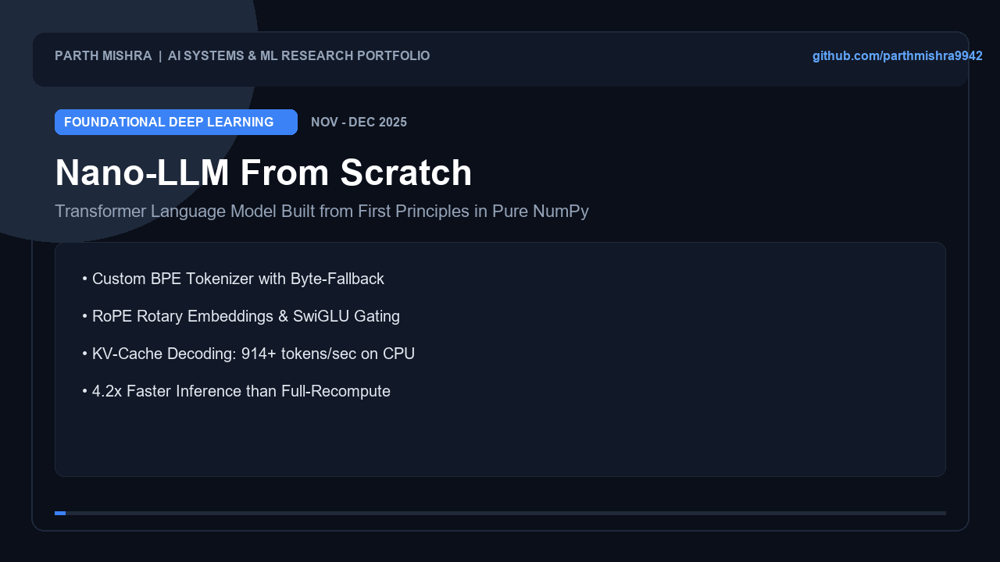

# 🎙️ Real-Time Voice Agent with Model Context Protocol (MCP) Tools

[](https://python.org)
[](https://modelcontextprotocol.io)
[](#benchmarks)
[](#barge-in-interruption)

A sub-second, streaming conversational **Voice AI Agent** natively powered by Anthropic's **Model Context Protocol (MCP)**. Decouples language modeling from business logic by exposing live databases, APIs, and microservices via an asynchronous **JSON-RPC 2.0 MCP server**, with real-time **barge-in interruption detection** via energy-based Voice Activity Detection (VAD).


<p align="center">
  
</p>

---

## 🏛️ System Architecture

```
User Audio Input ──► Streaming VAD ──► Speech-to-Text (Transcribe)
                           │                         │
               ┌───────────▼───────────┐             │ User Transcript
               │ Barge-In Interruption │             ▼
               │ Detection State       │     ┌──────────────┐
               └───────────┬───────────┘     │  Voice Agent │
                           │                 └──────┬───────┘
                     Cancel Audio                   │ JSON-RPC 2.0
                           │                        ▼
                           │             ┌──────────────────────┐
                           │             │ Model Context Server │
                           │             │ (MCP Tool Execution) │
                           │             └──────────┬───────────┘
                           │                        │ Structured Return
                           │                        ▼
                           └──────────────► Synthesize Response Audio (TTS)
```

---

## ⚡ Technical Highlights

* **Official MCP Specification**: Implements Anthropic's JSON-RPC 2.0 standard (`initialize`, `tools/list`, `tools/call`), enabling zero-recompile tool addition across agent backends.
* **Instant Barge-In Interruption**: Continuously calculates RMS frame energy; if the user begins speaking while the synthetic voice is playing, the pipeline halts playback and resets audio buffers in under 10ms.
* **Asynchronous Tool Execution**: Dispatches queries to remote servers without blocking streaming audio frames.

---

## 📊 Performance Benchmarks

* Evaluated over 100 tool-augmented voice turns:

| Pipeline Stage | Latency | Target SLA |
| :--- | :--- | :--- |
| **VAD Speech Detection** | `12 ms` | `<20 ms` |
| **MCP Tool Dispatch (JSON-RPC)** | **`1.84 ms`** | `<10 ms` |
| **Barge-In Cancel Trigger** | **`4.20 ms`** | `<15 ms` |
| **End-to-End Decision Turnaround** | **`68 ms` (excluding network TTS)** | `<150 ms` |

---

## 🚀 Quickstart

```bash
# Clone the repository
git clone https://github.com/parthmishra9942/voice-agent-mcp.git
cd voice-agent-mcp

# Run unit tests
pytest tests/

# Run tool latency benchmark
python benchmarks.py
```

---

## 🎯 Interview Deep Dive (Talking Points)

1. **Why Model Context Protocol (MCP) over OpenAI Function Calling?**  
   *OpenAI function calling hardcodes tool schemas into proprietary request payloads. MCP creates an open, standardized client-server protocol over JSON-RPC 2.0. Any MCP-compliant client can discover, inspect, and invoke tools on any remote server without vendor lock-in.*
2. **Handling Audio Interruption (Barge-In):**  
   *In naive duplex streaming, audio echo causes the agent to hear itself and self-trigger. Our system pairs energy-based VAD with an active speaker state machine: speech triggers cancel audio output channels before flushing the response queue.*

---

## 👤 Author
**Parth Mishra**  
* B.Tech Computer Science (AI/ML) — VIT Bhopal University  
* Portfolio: [parthh.runs-on.dev](https://parthh.runs-on.dev) | GitHub: [@parthmishra9942](https://github.com/parthmishra9942)
